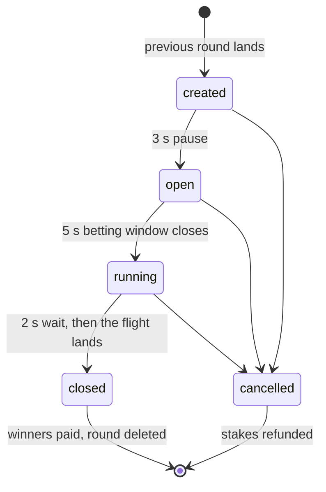
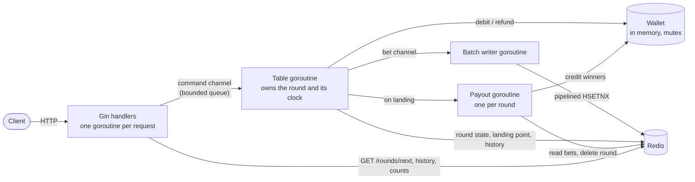
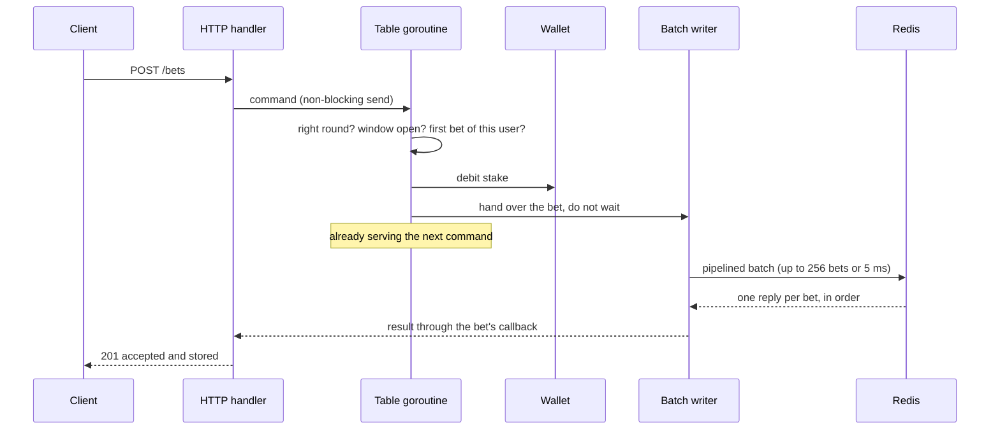

# Real-Time Betting Game Server

A Go server for **Aviator**, a real-time multiplayer betting game, built to show how goroutines and channels keep shared game state consistent under thousands of concurrent bets.

## Overview

Aviator is a crash-style betting game: a plane takes off, its multiplier climbs from 1.00x, and it lands at a random point. Players bet an amount and a target multiplier before take-off; if the plane reaches the target before landing, they win amount × target.

The project is a learning prototype that shows how Go coordinates thousands of concurrent requests against shared, time-driven state:

- **One goroutine owns the round.** HTTP handlers never touch it; they send commands over a channel and wait for the answer. That goroutine also runs the round's clock, so the decision "did this bet arrive before the window closed?" has exactly one judge.
- **Bets are persisted in batches.** A second goroutine collects accepted bets and writes them to Redis in one pipelined round-trip; each bettor still gets their own result.
- **Payouts run in the background.** When the plane lands, winners are paid in a separate goroutine while the next round is already being created.
- **It is deployed the way it would run on AWS**: as a container on Kubernetes (EKS), with its image in ECR and Redis on ElastiCache, all emulated locally with [MiniStack](https://ministack.org/).

There is no frontend, authentication or real money. Balances live in an in-memory wallet.

## How a round works



| State | Duration | What happens |
|---|---|---|
| `created` | 3 s | The round exists and announces when betting opens. No bets yet. |
| `open` | 5 s | The only state that accepts bets. |
| `running` | 2 s + flight | Betting is closed. The landing point is drawn and stored, pending bets are flushed to Redis, then the plane flies. |
| `closed` | until paid | The plane has landed. The result goes to the history, winners are paid asynchronously, and the next round is created at the same instant. |
| `cancelled` | until refunded | The round was cancelled. Every stake is refunded. |

Rules: one bet per user and round; the amount is a whole number of at least 1; the target multiplier is at least 1.01x with two decimals at most; landing exactly on the target wins.

## Architecture



The path of a single bet:



Redis keys:

| Key | Type | Content |
|---|---|---|
| `round:seq` | counter | Generates round ids; survives restarts. |
| `round:active` | string | Id of the active round. |
| `round:{id}` | hash | Start time, betting window, state, landing point. Deleted once the round is paid. |
| `bets:{id}` | hash | One field per user: amount and target. `HLEN` gives the bet count. Deleted once the round is paid. |
| `rounds:history` | list | The last 10 results (round id and landing point). |

## Tech stack

| Layer | Technology | Version |
|---|---|---|
| Language | Go | 1.27 |
| HTTP | Gin | 1.12.0 |
| Storage | Redis (go-redis client) | Redis 7/8, go-redis 9.23.0 |
| Container | Docker, distroless base image | |
| Orchestration | Kubernetes (Kustomize manifests) | k3s 1.31 |
| Cloud (emulated) | EKS, ECR and ElastiCache on MiniStack | MiniStack 1.5.17 |
| Tests | `testing`, `testing/synctest`, miniredis | miniredis 2.40.0 |
| Load testing | k6 | 2.2.0 |

## API

| Method | Path | Description |
|---|---|---|
| `GET` | `/rounds/next` | The active round: id, state, when betting opens and how long it lasts. |
| `POST` | `/bets` | Places a bet on a round. |
| `GET` | `/rounds/{roundId}/bets/count` | Number of bets in a round, as a bare integer. |
| `GET` | `/rounds/history` | Round id and landing multiplier of the last 10 rounds. |
| `POST` | `/rounds/test` | Cancels the round in progress and opens a test round now, with a longer betting window. This endpoint exists only for testing purposes. |
| `GET` | `/players/{userId}/balance` | A user's balance. |
| `GET` | `/health` | 200 when the service is up and Redis answers; 503 otherwise or while shutting down. |

`GET /rounds/next`

```json
{ "roundId": 42, "state": "created", "startTime": "2026-10-14T12:00:03Z", "bettingWindowSeconds": 5 }
```

`POST /bets`

```json
{ "roundId": 42, "userId": "user-1", "multiplier": 1.50, "amount": 10 }
```

```json
{ "roundId": 42, "userId": "user-1", "multiplier": 1.50, "amount": 10, "balance": 90.00 }
```

| Status | When |
|---|---|
| `201` | Accepted and stored in Redis. |
| `400` | Malformed body, amount not a whole number ≥ 1, multiplier below 1.01 or with more than two decimals. |
| `402` | Insufficient balance. |
| `404` | Unknown user, or unknown round when counting bets. |
| `409` | Not the active round, betting window closed, or the user already bet in this round. |
| `503` | Table queue full (back-pressure) or service shutting down. |

Users `user-1` to `user-N` (10 by default) are created at start-up with a balance of 100.00. Balances are reported with two decimals and no currency.

## Running locally

### Prerequisites

- Windows with PowerShell 5.1 or later.
- Docker Desktop. It also provides `kubectl`.
- Go 1.27 and k6, only to run the tests and the load test.

### Quick start

```powershell
.\scripts\start.ps1
```

The script deploys the whole stack on an emulated AWS and then follows the server logs:

1. Starts MiniStack, the local AWS emulator.
2. Builds the server image and pushes it to **ECR**.
3. Creates a Redis cluster on **ElastiCache**.
4. Creates an **EKS** cluster (MiniStack runs a real k3s cluster) and points it at the ECR registry.
5. Applies the Kubernetes manifests in [deploy/k8s/](deploy/k8s/) and waits for the rollout.
6. Forwards the service to `http://localhost:8080`.

The first run takes about two minutes. Options: `-Users 5000`, `-TestBettingWindow 30s` (60 s by default, convenient for manual testing) and `-Port 9090`.

### Run the demo

With the stack running, in another terminal:

```powershell
.\scripts\start.ps1 -Verify
```

It opens a test round, places five bets, waits for the landing, checks every balance against the landing multiplier, and then deletes the server pod to show the graceful shutdown while Kubernetes replaces it:

```
msg="shutdown 1/5: health reports unavailable"
msg="shutdown 2/5: http server stopped, in-flight requests finished"
msg="shutdown 3/5: table stopped"
msg="shutdown 4/5: pending bets written to redis"
msg="shutdown 5/5: payouts finished"
```

### Ports

| Port | Service |
|---|---|
| 8080 | Aviator API (port-forward to the Kubernetes service) |
| 4566 | MiniStack AWS endpoint and ECR registry |
| 16443 | EKS (k3s) API server |
| 16379 | ElastiCache Redis |

### Stop

`Ctrl+C` stops following the logs; the deployment keeps running. To delete the cluster, Redis, the registry and MiniStack:

```powershell
.\scripts\start.ps1 -Down
```

### Configuration

| Variable | Default | Meaning |
|---|---|---|
| `USERS` | 10 | Users created at start-up. |
| `INITIAL_BALANCE` | 100 | Starting balance of each user. |
| `ROUND_PAUSE` | 3s | Duration of `created`. |
| `BETTING_WINDOW` | 5s | Duration of `open`. |
| `PRE_FLIGHT_WAIT` | 2s | Wait between the close of betting and take-off. |
| `TEST_BETTING_WINDOW` | 15s | Betting window of a test round (`start.ps1` sets 60s). |
| `LANDING_MIN` / `LANDING_MAX` | 1.00 / 10.00 | Range of the random landing point. |
| `FLIGHT_GROWTH` | 0.2 | The multiplier is e^(growth × seconds) during the flight. |
| `TABLE_QUEUE_SIZE` | 1024 | Commands the table can queue before rejecting with 503. |
| `BATCH_MAX_SIZE` / `BATCH_MAX_WAIT` | 256 / 5ms | When the writer sends a batch to Redis. |
| `SHUTDOWN_TIMEOUT` | 10s | Upper bound for the graceful shutdown. |
| `REDIS_ADDR` / `PORT` | localhost:6379 / 8080 | Redis address and HTTP port. |

## Testing

```powershell
go test ./...
.\scripts\test-race.ps1
```

72 tests, all passing, also with the race detector. On Windows, `-race` needs cgo, so `test-race.ps1` runs the suite inside a `golang` container.

| Package | Coverage | Highlights |
|---|---|---|
| `internal/wallet` | 100% | 500 concurrent debits never overdraw a balance. |
| `internal/api` | 95.7% | Every endpoint, every error mapped to its status code. |
| `internal/payout` | 92.5% | Winners paid (ties included), settling never blocks the table. |
| `internal/store` | 91.3% | Redis operations and the batch writer against miniredis. |
| `internal/config` | 90.4% | Defaults, overrides and invalid values. |
| `internal/game` | 87.0% | Round lifecycle with exact timings, rejections, refunds, test rounds, concurrency. |

The table tests use `testing/synctest`, so time is simulated: a bet can be sent exactly 1 ms before the close, and a full round runs in milliseconds without flaky sleeps.

## Results

### Concurrency

Hundreds of goroutines hit the table at the same instant; the run is repeated 20 times with the race detector. Full report: [results/concurrency/](results/concurrency/README.md).


- **Burst at the close:** of 1,000 bets sent between 50 ms before and 49 ms after the close, the 500 sent before it were accepted and the 500 sent after it were rejected. None slipped through.
- **Same user, 200 simultaneous bets:** exactly one accepted, the balance debited once.
- **Saturated queue:** with the table busy, 484 bets were rejected immediately instead of piling up.

### Load

k6 sends every bet at a scheduled instant inside a real betting window, one bet per user. The production reference is an average of 5,000 bets per round. Full report, method and environment: [results/load/](results/load/README.md).


| Scenario | Bets per round | Accepted | p95 | Errors |
|---|---|---|---|---|
| Base | 5,000 | 100% | 11 ms | 0 |
| Burst (80% in the last second) | 5,000 | 100% | 27 ms | 0 |
| Stress 2x | 10,000 | 100% | 50 ms | 0 |
| Stress 5x | 25,000 | 96% | 223 ms | 0 |
| Stress 10x | 50,000 | 48% | 327 ms | 0 |

Across all 15 runs no bet was accepted after the close and the bets stored in Redis always matched the accepted ones. The rejections at 5x and 10x are bets that k6, sharing an 8-thread laptop with the server, sent too late; the server rejected them as it must. The load test runs the server natively against the Redis in `docker-compose.yml`, to measure the application rather than the emulator: `.\scripts\load-test.ps1`.

## Design decisions

- **A goroutine and channels for the table, a mutex for the wallet.** The round is a process with a clock: commands and timer events must be handled in one order by one owner, and `select` over the command channel, the timer and the shutdown context expresses that directly. The wallet is plain shared data with no lifecycle, so a mutex is the simpler tool.
- **The table never waits for Redis.** It validates, debits and hands the bet to the writer, then serves the next command. The HTTP handler is the one that waits, so "accepted" always means "stored".
- **Batching without losing per-bet results.** The writer pipelines up to 256 `HSETNX` commands in one round-trip. Redis answers each command in order, so every bettor gets their own outcome, including a duplicate.
- **Take-off waits for the flush.** The 2-second pre-flight wait is used to confirm every accepted bet in Redis. If a write fails, the stake is refunded before take-off.
- **Back-pressure instead of unbounded queues.** Commands enter the table's bounded queue with a non-blocking send; when it is full, the request gets 503 at once.
- **Exact money.** Balances are integer cents and multipliers integer hundredths, so amount × target gives the payout in cents with no rounding.
- **Refunds come from Redis, not memory.** When a test round cancels a round, the refunds are computed from the stored bets. A bet whose write failed was already refunded and is not in Redis, so it can never be refunded twice.
- **One replica, recreated.** Only one clock can own a round, so the Deployment runs a single replica with the `Recreate` strategy: a rolling update would briefly run two tables on the same Redis.
- **Probes that do not cascade.** Readiness checks `/health`, which includes Redis; liveness only checks the TCP port, so a Redis outage takes the pod out of rotation without making Kubernetes restart it in a loop.
- **Ordered shutdown.** On `SIGTERM`: health reports 503, HTTP stops and finishes in-flight requests, the table stops, the writer flushes, pending payouts finish.

## Limitations and next steps

- **Single instance.** The round lives in one process. Scaling out means several tables, one goroutine each, sharded across instances by table id.
- **In-memory wallet.** Balances reset on restart. A real system would call a wallet service and debit within the same transaction that records the bet.
- **No payout recovery.** If the process dies mid-payout, the round stays in Redis as `closed` and is not resumed.
- **The landing point is in Redis before take-off.** The API never exposes it, but anyone with Redis access could read it. A real game would use a provably fair scheme.
- **Emulated AWS.** On real AWS, the image name in [deploy/k8s/kustomization.yaml](deploy/k8s/kustomization.yaml) becomes the ECR URI, `REDIS_ADDR` becomes the ElastiCache endpoint, credentials come from `aws eks update-kubeconfig`, and the service would sit behind a load balancer instead of a port-forward.

## Project structure

```
cmd/server/             entry point, wiring and graceful shutdown
cmd/concurrency-report/ builds results/concurrency from the test output
cmd/load-report/        builds results/load from the k6 summaries
internal/api/           Gin routes, handlers and error mapping
internal/config/        configuration from environment variables
internal/game/          domain types, rules and the table goroutine
internal/payout/        asynchronous payouts
internal/store/         Redis store and batch bet writer
internal/wallet/        in-memory wallet
deploy/k8s/             Kubernetes manifests (Kustomize)
loadtest/               k6 script
results/                published test and load reports
scripts/                start, verify, tests and load test
```

## License

[MIT](LICENSE)
